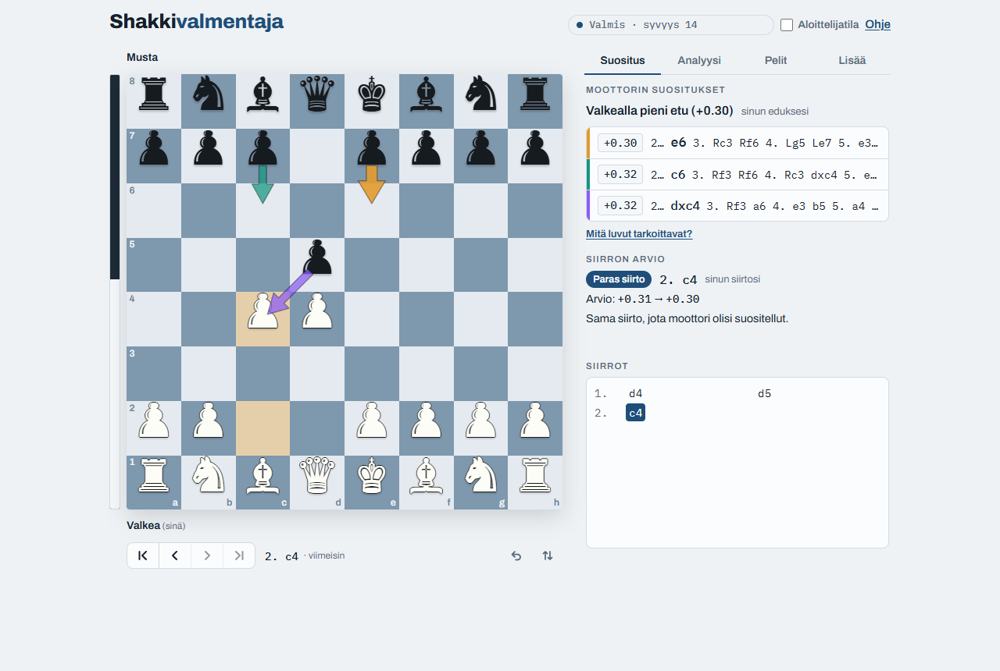

# Shakkivalmentaja

[](https://github.com/tapiotorsti/shakkivalmentaja/actions/workflows/test.yml)
[](LICENSE)
[](https://shakkivalmentaja.web.app)
[](package.json)

*[In English: README.md](README.md)*

**Sovellus: [shakkivalmentaja.web.app](https://shakkivalmentaja.web.app)**

Shakkilauta, johon syötetään siirrot ja Stockfish näyttää parhaat jatkot nuolina. Sovellus analysoi koko pelin, merkitsee virheet, hakee omat pelit Lichessistä ja Chess.comista, ja sillä voi pelata konetta vastaan. Pelikirjasto tallentaa analysoidut pelit laitteelle (IndexedDB), ja omista virheistä kootaan kertaavia harjoitustehtäviä. Aloittelijatila selittää siirrot sanoin, ja Opi pelaamaan -opetus näyttää tehtävinä, miten kukin nappula liikkuu.

Kaikki toimii selaimessa ilman palvelinta: moottori, analyysi ja pelikirjasto pysyvät käyttäjän omalla laitteella.



## Rakenne

| Tiedosto | Mitä se on |
|---|---|
| `src/index.html` | Sivun rakenne. Rakennus täyttää siinä olevat paikkamerkit. |
| `src/styles.css`, `src/help.html` | Tyylit ja ohjeikkuna. |
| `src/js/` | Sovelluksen koodi ominaisuuksittain (lauta, moottori, analyysi, kirjasto, harjoitus, opetus jne.). |
| `build.js` | Kokoaa osat: `dist/shakkivalmentaja.html` (yksi itsenäinen tiedosto) sekä Firebase-versio `public/index.html` (Stockfish 19, pelien haku, PWA) ja `public/sw.js`. |
| `public/` | Firebase Hostingin tiedostot: moottori, chess.js, kuvakkeet, manifesti. |
| `tests/` | Selaintestit headless-Chromella. |
| `tools/make_icons.py` | Luo sovelluksen kuvakkeet (vaatii Pillow-kirjaston). |
| `AGENTS.md`, `.claude/skills/` | Ohjeet ja työnkulut AI-koodaustyökaluille. `CLAUDE.md` tuo `AGENTS.md`:n sisällön Claude Codelle. |

JavaScript-tiedostot kootaan `build.js`:ssä luetellussa järjestyksessä yhden funktion sisään, joten ne jakavat saman näkyvyysalueen. Uusi tiedosto lisätään listaan oikeaan kohtaan.

`dist/shakkivalmentaja.html` toimii sellaisenaan esimerkiksi claude.ai-artifactina. Silloin käytössä on Stockfish 10 CDN:stä, eikä pelien hakua ole.

## Komennot

Vaatii Node 22:n tai uudemman. Sovelluksella ei ole riippuvuuksia; `npm ci` asentaa vain kehitystyökalut (ESLint).

```sh
npm ci                # vain kehitystyökalut (ESLint)
npm run lint          # ESLint; src/js-tiedostot tarkistetaan yhdessä samana näkyvyysalueena
npm run test:unit     # pelkät yksikkötestit (alle sekunti, ei selainta)
npm test              # yksikkötestit, sitten rakennus ja kaikki selaintestit (noin 2–3 min)
npm run test:offline  # sama ilman Lichessiä ja Chess.comia käyttäviä testejä
npm run build         # pelkkä rakennus: dist/ ja public/
npm run deploy        # julkaisu Firebaseen (rakentaa ensin automaattisesti)
```

Yksittäiset testit: `node tests/run.mjs --only peli,välilehdet`. Testit tarvitsevat Chromen tai Edgen. Polun voi antaa `CHROME_PATH`-muuttujalla. Kuvakaappaukset tallentuvat kansioon `tests/output/`.

Aja `npm test` ennen julkaisua.

## Huomioita

- Chess.comin kuluvan kuukauden arkisto voi palauttaa virheen, vaikka käyttäjä on olemassa. Haku ohittaa virheelliset kuukaudet ja hakee aiemmista.
- Lichessin rajapinta palauttaa 404, jos selaimen tunniste on `HeadlessChrome` tai curlin oletus. Testit vaihtavat tunnisteen tavalliseksi Chromeksi. Oikeilla käyttäjillä haku toimii normaalisti.
- Moottorin vaihtuessa tarkista `ENGINE_INFO` (`build.js`): Stockfish 10:n arvot skaalataan kertoimella 0,7 (`cpScale`), uusilla versioilla kerroin on 1.

## Lisenssi

[GPL-3.0](LICENSE). Sovelluksen mukana jaetaan Stockfish, jonka lisenssi on GPLv3. Muiden osien lisenssit: [THIRD_PARTY_NOTICES.md](THIRD_PARTY_NOTICES.md).
