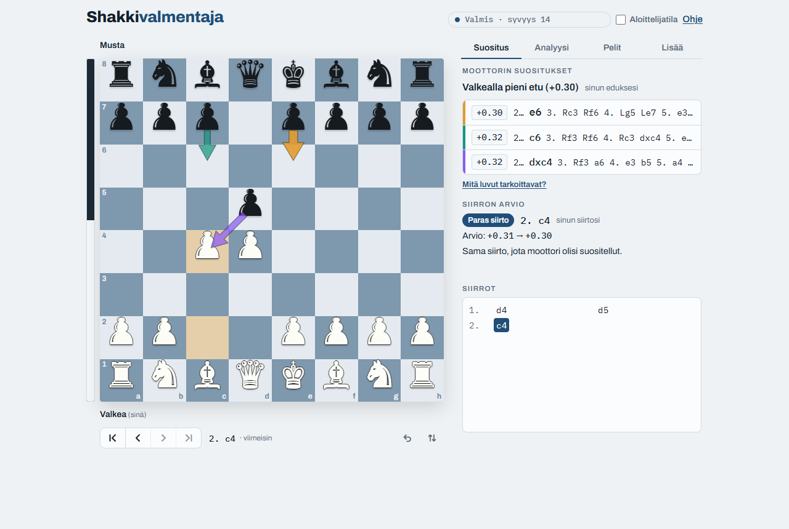
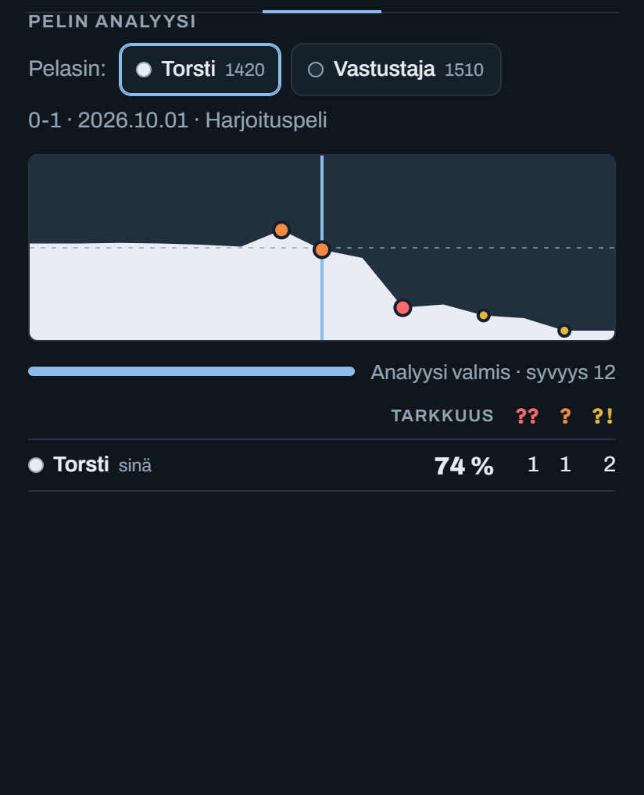
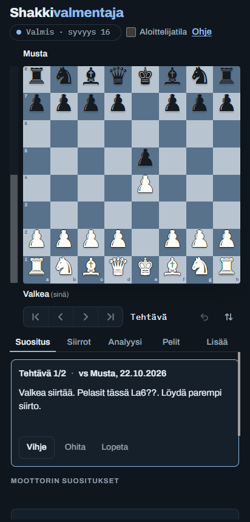
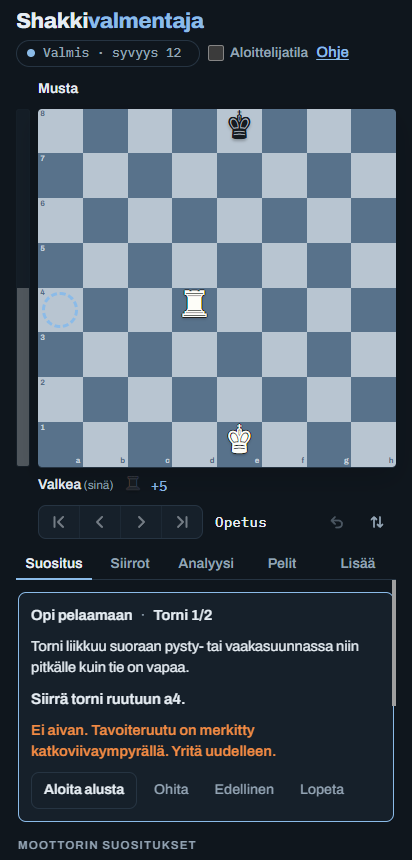

# Shakkivalmentaja – a chess coach in the browser

[](https://github.com/tapiotorsti/shakkivalmentaja/actions/workflows/test.yml)
[](CHANGELOG.md)
[](LICENSE)
[](https://shakkivalmentaja.web.app)
[](package.json)

*[Suomeksi: README.fi.md](README.fi.md)*

**Live app: [shakkivalmentaja.web.app](https://shakkivalmentaja.web.app)** (Finnish UI, installable as a PWA, works offline)

Shakkivalmentaja ("chess coach") is a Finnish-language chess training app. Stockfish runs in the browser and shows the best moves as arrows on the board. The app reviews whole games, imports your own games from Lichess and Chess.com, and turns your mistakes into puzzles for spaced-repetition practice. It has no backend: the engine, the analysis and the game library all run on your own device.



| Game analysis | Practise your mistakes | Learn to play |
|---|---|---|
|  |  |  |

## Features

- **Live engine suggestions:** up to three candidate moves as coloured arrows, with an evaluation bar and a plain-language verdict ("White has a small advantage").
- **Move review:** each move is classified as best, good, inaccuracy, mistake or blunder. The classification uses how much the mover's winning chances dropped (the same win-probability model as Lichess), not the raw centipawn loss.
- **Whole-game analysis:** an evaluation graph, accuracy for both players and the game's turning points. Earlier positions are evaluated in the background while you browse.
- **Import your games:** fetch recent games from Lichess or Chess.com by username, or paste PGN. Variations let you try alternative lines without losing the original game.
- **Play against the computer:** eight strength levels. While a game is in progress, engine help is hidden and hints are counted.
- **Practise your mistakes:** every analysed game feeds a puzzle set built from your own mistakes and blunders. Puzzles are scheduled with a Leitner system (10 min → 1 → 3 → 7 → 21 days). If you find a different move that is nearly as good as the engine's choice, the engine verifies it and accepts it.
- **Game library:** analysed games are stored in IndexedDB with their evaluations, so reopening a game needs no new analysis.
- **Beginner mode and lessons:** explains moves in words, warns about pieces that can be captured, and teaches how each piece moves through short on-board tasks.

## How it is built

- **No framework, no runtime dependencies.** The app is plain JavaScript, HTML and CSS in [src/](src/), with [chess.js](https://github.com/jhlywa/chess.js) for move rules. The JavaScript is split into 20 files by feature (board, engine, analysis, library, practice, lessons and so on). The build concatenates them, in a fixed order, into one function scope.
- **Stockfish 19 (WebAssembly) in Web Workers.** One worker analyses the position shown on the board and evaluates earlier positions in the background. A second worker plays as the opponent and checks moves in the puzzles.
- **One source, two builds.** [build.js](build.js) builds two versions from `src/`. The first is a single self-contained HTML file that uses Stockfish 10 from a CDN and runs anywhere, for example as a claude.ai artifact. The second is the hosted PWA, which adds Stockfish 19, the service worker, the manifest and game fetching. Evaluations are rescaled per engine (`ENGINE_INFO.cpScale`) so that move classifications stay consistent between the two engines.
- **Locked-down hosting.** The build adds a Content Security Policy that allows only the page's own scripts (by sha256 hash), its own files, Google Fonts and the Lichess/Chess.com APIs. `firebase.json` adds `frame-ancestors`, `nosniff`, `Referrer-Policy` and `Permissions-Policy`. A browser test checks that the app causes no CSP violations and that an injected script is blocked.
- **Offline first.** A versioned service worker caches the app and the engine. The page itself is fetched network-first so that updates arrive.
- **Unit tests against the real source.** The source files are not modules, so [tests/unit/harness.mjs](tests/unit/harness.mjs) loads them into a Node `vm` context in build order, with chess.js and a minimal DOM stub. The `node:test` suites then call the app's own functions directly: move classification, accuracy, beginner hints, PGN parsing, the review schedule and the Lichess/Chess.com response parsing (with a stubbed `fetch`). They run in under a second and have already caught a bug in the beginner hints.
- **Browser tests without a test framework.** [tests/run.mjs](tests/run.mjs) builds the app, serves it locally, and drives headless Chrome through the DevTools protocol using only Node's standard library. Eleven suites cover navigation, animations, layout stability, analysis, play, the library and practice, lessons, security (CSP), accessibility (keyboard play, screen-reader labels, status messages) and game fetching.

## Running locally

Requires Node 22+ and Chrome or Edge (set `CHROME_PATH` if it is not found automatically). The app itself has no dependencies; `npm ci` installs only the development tools (ESLint).

```sh
npm run build         # build dist/shakkivalmentaja.html and public/ (index.html, sw.js)
npm ci                # dev tools only (ESLint)
npm run lint          # ESLint; the src/js files are checked together, as one scope
npm run test:unit     # unit tests only (<1 s, no browser needed)
npm test              # unit tests, then build and run all browser tests (~2–3 min)
npm run test:offline  # the same without the tests that call Lichess and Chess.com
```

To try the app, serve `public/` with any static file server after building, for example `npx serve public`. To deploy to your own Firebase project, run `npm run deploy` (requires the Firebase CLI and your own project ID in `.firebaserc`).

| Path | Contents |
|---|---|
| `src/index.html` | Page markup, with placeholders that the build fills in |
| `src/styles.css`, `src/help.html` | Styles and the help dialog |
| `src/js/` | App code by feature; the build order is listed in `build.js` |
| `build.js` | Builds `dist/shakkivalmentaja.html` (standalone) and `public/` (hosted) |
| `public/` | Static assets: Stockfish, chess.js, icons, manifest |
| `tests/` | Headless-Chrome browser tests |
| `tools/` | Icon generator (`make_icons.py`, requires Pillow) and the GitHub social preview (`social-preview.html`, rendered with `make_social_preview.sh`) |
| `AGENTS.md`, `.claude/skills/` | Instructions and workflows for AI coding agents (`CLAUDE.md` imports `AGENTS.md`) |

## Changes

See [CHANGELOG.md](CHANGELOG.md).

## License

[GPL-3.0](LICENSE). The app ships Stockfish, which is GPLv3. For third-party components and their licenses, see [THIRD_PARTY_NOTICES.md](THIRD_PARTY_NOTICES.md).

Use the engine for analysis and training, not in live games against other people.
